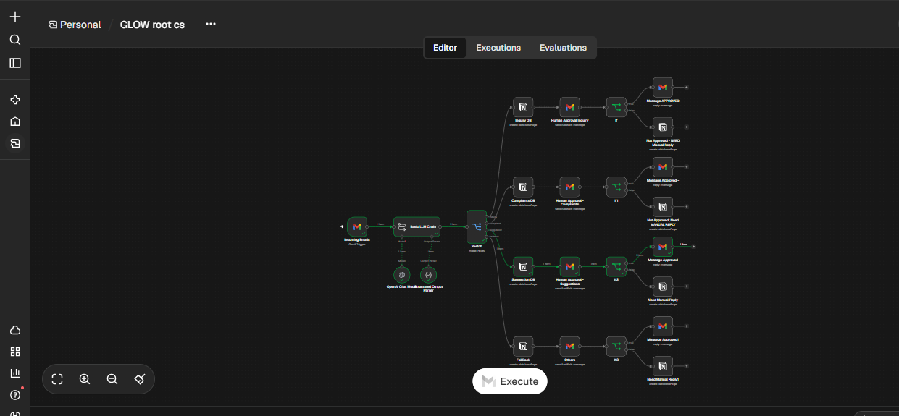
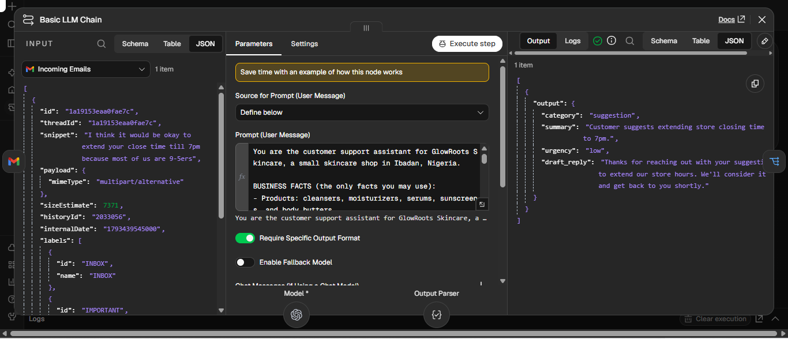
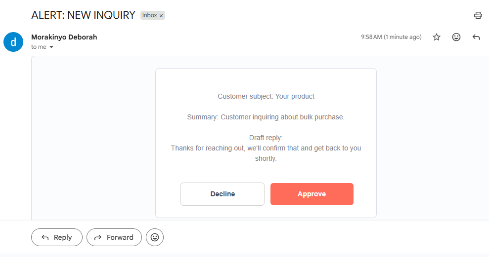
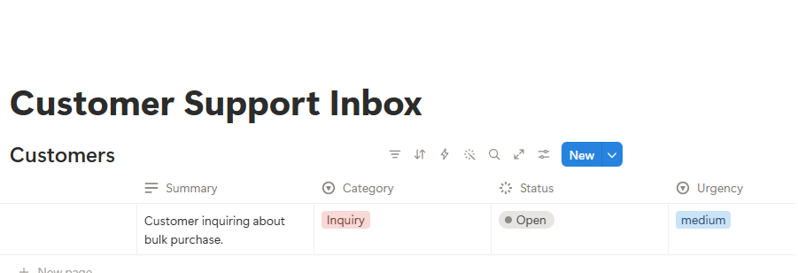
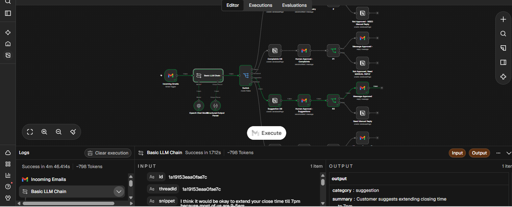

# AI Support Email Triage with Human Approval (n8n)

An n8n workflow that reads incoming customer emails, classifies them, routes each one to the right team, and prepares a reply that a person must approve before anything is sent.

> GlowRoots Skincare is a fictional shop in Ibadan, used as a practice business.

## The problem
When every customer message lands in one inbox, someone has to read all of it, decide who should handle each one, and write the replies. It's repetitive, takes lot of time and also easy to get wrong.

## What it does
1. A new email arrives in the business Gmail inbox.
2. An AI model classifies it (complaint, inquiry, suggestion, or other), summarizes it, rates its urgency, and drafts a reply using only the business's own facts.
3. A Switch routes it to the right team.
4. A task is created in Notion for that team.
5. The team member gets an email with the customer's message summary and the draft, with Approve and Disapprove buttons.
6. On approval, the reply is sent from the business inbox in the original thread. On disapproval, nothing is sent and the team member replies manually.

## Design decisions
- **A human always approves.** The workflow can't send a reply without a click.
- **The AI can't guess.** It's told never to invent prices, stock, or delivery dates, and to say "we'll confirm" when a fact isn't provided.
- **Health safety.** It never gives medical advice. Reports of burning, swelling, or a reaction are flagged as high urgency and told to see a doctor.
- **Prompt-injection defense.** Email text is treated as data, never as instructions.
- **Nothing gets lost.** Unclear emails fall through to an "other" route.

## Tech stack
n8n, an LLM API, Gmail, Notion.

## Screenshots

## Setup
1. Import `support-triage.json` into n8n.
2. Connect your own Gmail, Notion, and LLM credentials.
3. Create a Notion database with: Name, Category, Urgency, Summary, Status.
4. Replace the business facts in the AI prompt with your own.
5. Set the approval recipient for each team, then activate the workflow.
